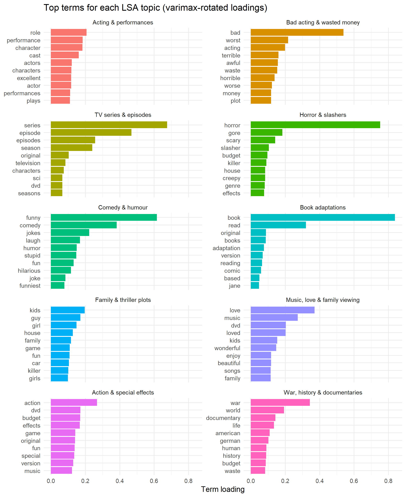
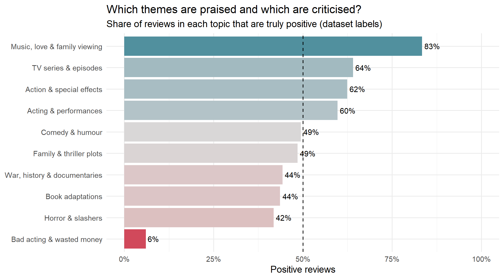

# Movie Review Topic Discovery Using LSA

Star ratings tell us **whether** viewers liked a film, not **why**. This project reads IMDb movie reviews in R, discovers the hidden themes people write about with **Latent Semantic Analysis (LSA)**, measures how they feel about each theme with **sentiment analysis**, and shows which themes audiences praise and which they criticise. An interactive **Shiny dashboard** predicts the sentiment of any review, or the overall public opinion of a movie.



## Key results

| Result | Value |
| --- | --- |
| Topics discovered with LSA | 10 (k chosen from the scree plot) |
| Most praised theme | Music, love & family viewing (83% of reviews positive) |
| Most criticised theme | Bad acting & wasted money (6% positive) |
| Best sentiment dictionary | Bing, 73.4% accuracy (AFINN 70.0%, NRC 65.2%) |
| Logistic regression (report, 10,000-review sample) | 84.8% accuracy on held-out reviews |
| Dashboard model (25,000 unseen test reviews) | **88.2% accuracy** |
| Movie-level public opinion | predicted share of positive reviews within 8.5 points on average (767 test movies) |



## Dataset

[IMDb Large Movie Review Dataset](https://ai.stanford.edu/~amaas/data/sentiment/) (Maas et al., 2011): 50,000 reviews, 25,000 positive and 25,000 negative. Reviews rated 4 stars or fewer are negative and 7 or more positive; neutral reviews are excluded. The official split has 25,000 training and 25,000 test reviews from different movies. The dataset is not stored in this repository; `prepare_data.R` builds it from the Stanford download.

## Pipeline

1. **Explore and clean**: remove HTML tags, numbers and punctuation; lowercase; check review lengths and ratings.
2. **Tokenize and weight**: split reviews into words (`tidytext`), remove stop words, check Zipf's law, compute tf-idf.
3. **Document-term matrix**: 10,000 reviews × 5,724 words of tf-idf weights, stored as a sparse matrix.
4. **LSA topics**: truncated SVD (`irlba`), k = 10 from the scree plot, varimax rotation, topics named from their top words.
5. **Sentiment**: score every review with the AFINN, Bing and NRC lexicons; profile NRC emotions per topic.
6. **Validation**: accuracy and confusion matrices against the true labels, negation handling, lasso logistic regression (`glmnet`) and LIME explanations.

## Repository structure

| Path | What it is |
| --- | --- |
| `movie_review_lsa.Rmd` | The analysis report: all six stages, with code and 19 figures |
| `movie_review_lsa.html` | The knitted report (open in any browser) |
| `app.R` | The Shiny dashboard |
| `R/features.R` | Text cleaning and features shared by training and the dashboard |
| `R/landing.R`, `www/` | The dashboard's landing page (intro, 3D topic carousel) |
| `prepare_data.R` | Builds `data/imdb_reviews.csv` from the Stanford archive |
| `get_lexicons.R` | Downloads the AFINN and NRC lexicons into `lexicons/` |
| `train_model.R` | Trains the dashboard model and saves `model/model_bundle.rds` |
| `install_packages.R` | Installs every R package the project needs |
| `outputs/` | Figures (`outputs/figures/`) and result tables (CSV) from the report |
| `docs/Figure_Guide.docx` | A guide explaining what each figure shows and means |
| `Movie_Review_LSA_Sentiment_Report.docx` | The written project report |
| `Movie-Review-Topic-Discovery-Using-LSA Modified.pdf` | The project presentation |

## How to run

Requirements: [R](https://cran.r-project.org/) 4.2 or later and [RStudio](https://posit.co/download/rstudio-desktop/). Run every step from the project folder (in RStudio: **Session → Set Working Directory → To Source File Location**).

1. **Install the packages** (once):

   ```r
   source("install_packages.R")
   ```

2. **Get the data**: download `aclImdb_v1.tar.gz` from the [Stanford page](https://ai.stanford.edu/~amaas/data/sentiment/) into a `data/` folder, then:

   ```r
   source("prepare_data.R")   # writes data/imdb_reviews.csv (about 1 minute)
   ```

3. **Get the lexicons** (AFINN and NRC):

   ```r
   source("get_lexicons.R")
   ```

4. **Knit the report**: open `movie_review_lsa.Rmd` and click **Knit** (about 3 minutes).

5. **Train the dashboard model** (once, about 5 minutes):

   ```r
   source("train_model.R")
   ```

6. **Run the dashboard**: open `app.R` and click **Run App**.

## The dashboard

- **Predict a review**: type any review and get POSITIVE or NEGATIVE with a probability, its main topic, the words that drove the prediction, and a comparison with the three lexicons.
- **Predict a movie**: pick one of 767 IMDb test-set movies, or paste your own reviews, to get the predicted share of positive reviews, the topics viewers discuss and the most typical review.
- **Model performance**: accuracy, confusion matrix, predicted vs actual opinion per movie, and the strongest words in the model.

## R packages

tidytext, textdata, dplyr, tidyr, stringr, readr, forcats, Matrix, irlba, glmnet, caret, lime, ggplot2, scales, wordcloud, RColorBrewer, reshape2, rmarkdown, knitr, shiny, bslib, htmltools, jsonlite.

## Limitations

- Lexicons miss negation and sarcasm, and misread movie words such as *plot*, *funny* and *kill*.
- LSA needs a judgement call on k and human naming of topics; LDA would give cleaner topics.
- The dataset excludes neutral (5–6 star) reviews.
- The model needs reviews to predict a movie's reception; it cannot forecast an unreleased film.

## References

- Deerwester, S. et al. (1990). Indexing by latent semantic analysis. *JASIS*, 41(6), 391–407.
- Hu, M. & Liu, B. (2004). Mining and summarizing customer reviews. *KDD 2004*.
- Maas, A. L. et al. (2011). Learning word vectors for sentiment analysis. *ACL 2011*.
- Mohammad, S. M. & Turney, P. D. (2013). Crowdsourcing a word-emotion association lexicon. *Computational Intelligence*, 29(3).
- Nielsen, F. Å. (2011). A new ANEW: Evaluation of a word list for sentiment analysis in microblogs.
- Silge, J. & Robinson, D. (2017). *Text Mining with R: A Tidy Approach*. O'Reilly.
