# About this guide

The project discovers 10 hidden themes in IMDb movie reviews with LSA, measures sentiment with three dictionaries and a trained model, and shows which themes viewers praise or criticise. This guide walks through all 19 figures in the R Markdown report (`movie_review_lsa.html`). Each figure has four parts: **What it shows**, **How to read it**, **What it means**, and **Say this to faculty**.

**Dataset.** IMDb Large Movie Review Dataset (Maas et al., Stanford, 2011): 50,000 reviews, perfectly balanced at 25,000 positive and 25,000 negative. Reviews of 4 stars or fewer are labelled negative and 7 stars or more positive; neutral 5–6 star reviews are excluded. The report analyses a balanced random sample of **10,000 reviews** (seed 2026).

**Pipeline.** Each figure belongs to one of six stages:

1. **Explore and clean**: remove HTML tags, numbers and punctuation; lowercase; check lengths and ratings.
2. **Tokenize and weight**: split into words, remove stop words, count words, compute tf-idf.
3. **Document-term matrix**: 10,000 reviews × 5,724 words of tf-idf weights (99% zeros).
4. **LSA topics**: SVD, k = 10 chosen from a scree plot, varimax rotation, topics named from top words.
5. **Sentiment**: score every review with the AFINN, Bing and NRC dictionaries; average per topic.
6. **Validation**: compare with true labels; add negation handling; train logistic regression; explain it with LIME.

**Key results at a glance.**

| Result | Value |
|---|---|
| Topics discovered | 10 (k chosen from the scree plot) |
| Most praised topic | Music, love & family viewing (83% positive) |
| Most criticised topic | Bad acting & wasted money (6% positive) |
| Best dictionary | Bing (73.4% accuracy) |
| Logistic regression (report) | 84.8% accuracy on held-out reviews |
| Dashboard model (25,000 unseen test reviews) | 88.2% accuracy |

# Stage 1: Exploring the data

The data is clean, balanced and polarised: length does not reveal sentiment, so the words themselves must be read.

## Figure 1. Review length by sentiment

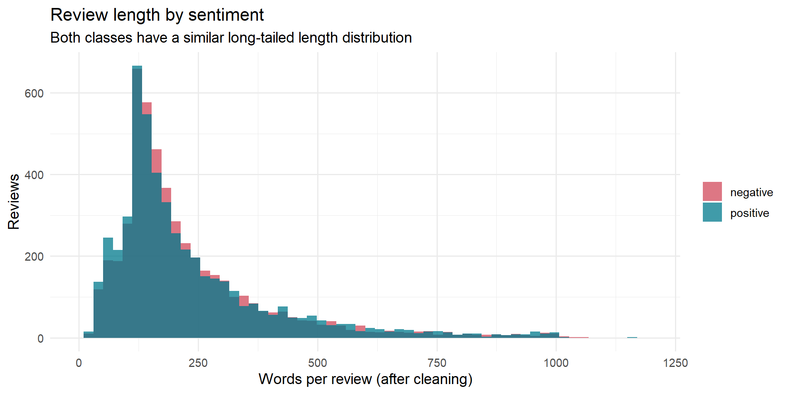{width=6.3in}

**What it shows.** A histogram of how many words each review has after cleaning, with positive reviews in teal and negative reviews in red.

**How to read it.** The two shapes overlap almost exactly. Most reviews are 100–300 words, with a long tail of very long reviews. Average length is 232 words (positive) vs 228 words (negative); medians are 171 and 173.

**What it means.** Review length carries no information about sentiment. A model cannot cheat by counting words; it has to understand which words are used.

**Say this to faculty.** "Before modelling, we checked whether length alone separates the classes. It does not: the distributions are nearly identical, so sentiment must come from the vocabulary."

## Figure 2. Star ratings in the sample

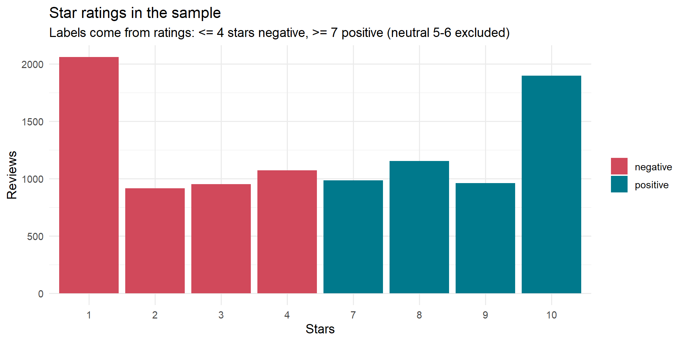{width=6.3in}

**What it shows.** The number of reviews at each star rating, coloured by their sentiment label.

**How to read it.** Ratings 1–4 are all red (negative) and 7–10 all teal (positive). There are no 5- or 6-star reviews. 1 star and 10 stars are the most common ratings. Mean rating is 2.21 for negative reviews and 8.76 for positive ones.

**What it means.** It confirms how the labels were built: 4 stars or fewer is negative, 7 or more is positive, and neutral reviews were removed by the dataset authors. Every review expresses a clear opinion, which makes the task cleaner than real-world reviews.

**Say this to faculty.** "The labels come from star ratings, with neutral 5–6 star reviews excluded. That is why our accuracy measures a clear positive-vs-negative task, and why neutral reviews are listed as a limitation."

# Stage 2: Words, Zipf's law and tf-idf

Raw word counts are dominated by a few generic words, so the project weights words with tf-idf instead. After cleaning, the sample holds 2,300,509 words; 860,552 remain once stop words are removed, across 54,415 distinct words.

## Figure 3. Most frequent words

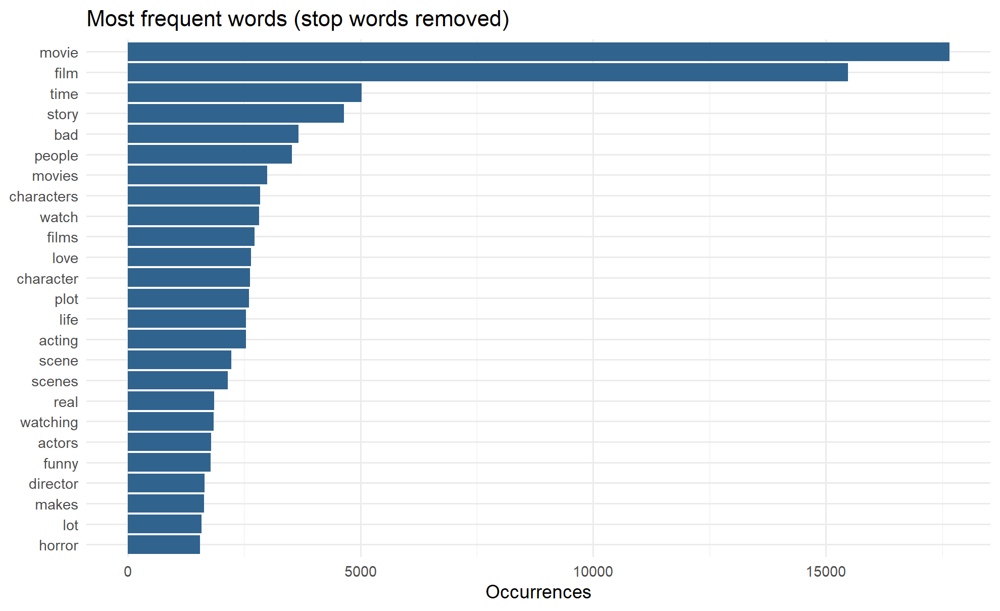{width=6.3in}

**What it shows.** The 25 most common words after removing stop words such as *the*, *is* and *and*.

**How to read it.** *movie* (about 17,500 times) and *film* (about 15,500) tower over everything else. Next come *time*, *story*, *bad* and *people*. Content words such as *acting*, *plot*, *funny* and *horror* appear lower down.

**What it means.** Raw counts are dominated by words that appear in almost every review and say nothing about its topic. This is why *movie*, *film*, *watch* and similar words were removed as "domain stop words", and why tf-idf is used instead of counts.

**Say this to faculty.** "Frequency alone is misleading: the top words are just *movie* and *film*. That motivated tf-idf weighting and a domain-specific stop-word list."

## Figure 4. Zipf's law in IMDb reviews

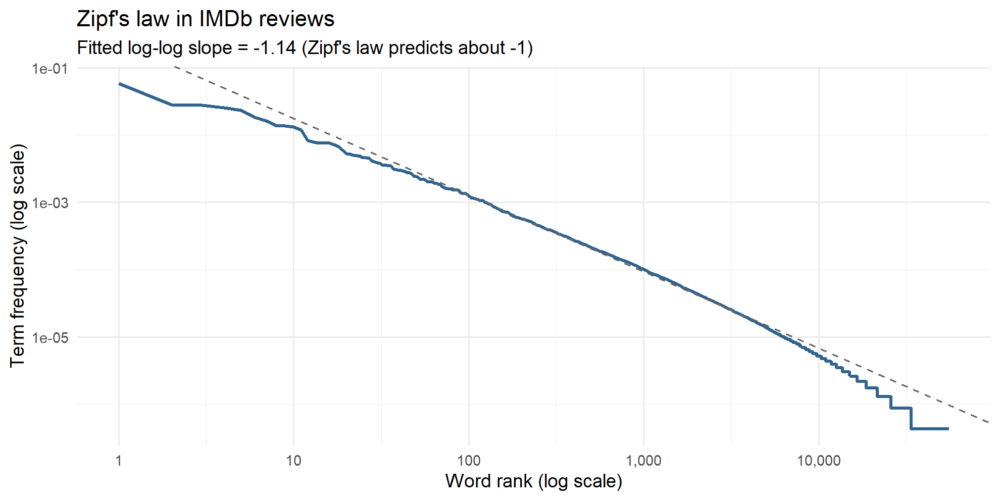{width=6.3in}

**What it shows.** Each word's frequency rank (x) against how often it occurs (y), both on logarithmic scales. The dashed line is a fitted straight line.

**How to read it.** The curve is close to a straight line with a **fitted slope of −1.14**. Zipf's law predicts a slope of about −1. Only the rarest words, at the far right, fall below the line.

**What it means.** Word frequency is roughly proportional to 1 ÷ rank: the 2nd word appears about half as often as the 1st, the 10th about a tenth as often. A handful of words make up most of the text and most words are rare. This is a universal property of language and explains why raw counts cannot measure importance.

**Say this to faculty.** "Our reviews follow Zipf's law with a slope of −1.14, very close to the theoretical −1. It confirms a few words dominate, which justifies down-weighting common words with idf."

## Figure 5. Highest tf-idf words for each star rating

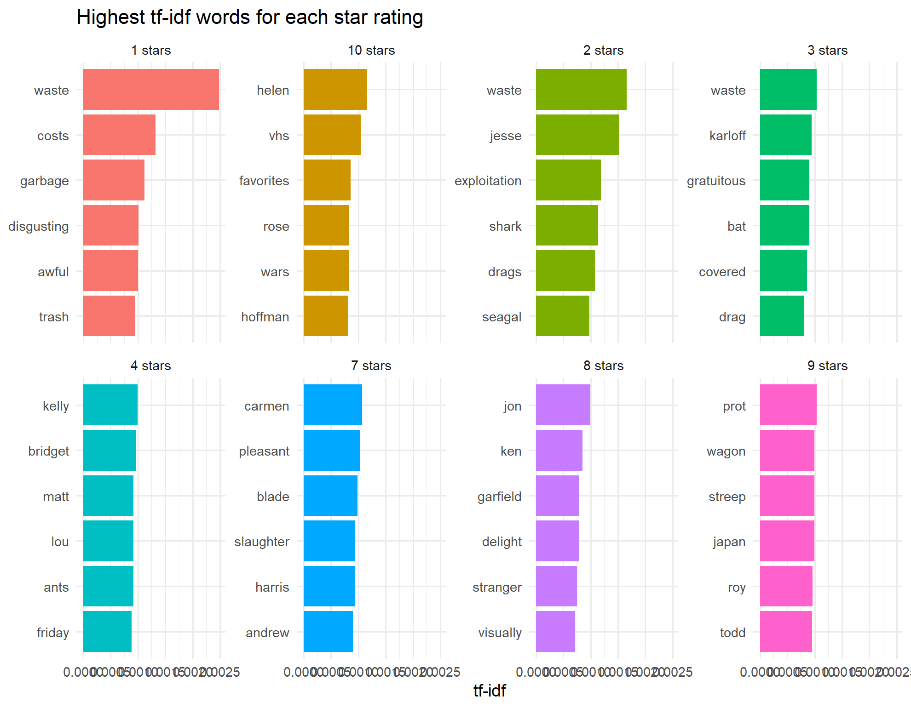{width=6.3in}

**What it shows.** For each star rating, treated as one big document, the 6 words with the highest tf-idf: the words most distinctive to that rating.

**How to read it.** The 1-, 2- and 3-star panels share *waste*, plus *garbage*, *disgusting*, *awful* and *trash*. The 7–10 star panels are mostly names (*helen*, *streep*, *carmen*) and words such as *favorites*, *delight* and *pleasant*.

**What it means.** tf-idf = term frequency × inverse document frequency. It scores a word high when it is frequent in one group but rare in the others. Negative reviews share a strong common vocabulary of disappointment. Positive reviews are more specific to the films and actors being praised.

**Say this to faculty.** "tf-idf surfaces what is unique to each rating. *Waste* is the signature word of 1–3 star reviews, while high ratings are distinguished by names of praised actors and films."

# Stage 4: LSA topic discovery

LSA compressed 5,724 word columns into 10 readable topics, discovered without any labels. Stage 3 built the input: a document-term matrix of 10,000 reviews × 5,724 words holding tf-idf weights. LSA factorises it with Singular Value Decomposition (SVD):

$$A \approx U_k \, \Sigma_k \, V_k^{T}$$

Here A is the review × word matrix, U links reviews to topics, Σ holds each topic's strength and V links words to topics. Words that appear in the same reviews end up in the same topic.

## Figure 6. Scree plot of the LSA dimensions

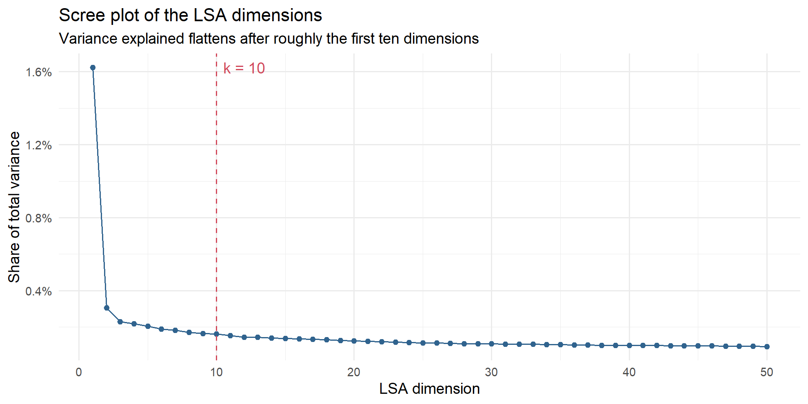{width=6.3in}

**What it shows.** The share of total variance captured by each of the first 50 LSA dimensions. The red dashed line marks k = 10.

**How to read it.** Dimension 1 explains 1.62%. The curve falls steeply, then flattens: by dimension 10 each extra dimension adds only 0.16%. Together, the first 10 explain 3.45% and all 50 explain 7.95%.

**What it means.** The "elbow" where the curve flattens marks where extra topics stop adding much, so k = 10 was chosen. The percentages are small because text matrices are extremely spread out over thousands of words; a target such as "80% of variance" is impossible here, so the elbow is the standard rule.

**Say this to faculty.** "We chose k = 10 from the elbow of the scree plot. The variance numbers look small, but that is normal for sparse text data: the elbow, not a variance target, is the accepted criterion."

## Figure 7. Top terms for each LSA topic

{width=6.3in}

**What it shows.** One small bar chart per topic, listing the 10 words with the highest loading (weight) on that topic after a varimax rotation.

**How to read it.** Longer bars mean the word defines the topic more strongly. Horror & slashers is driven by *horror* (loading about 0.75), then *gore*, *scary* and *slasher*. Book adaptations is driven by *book* and *read*. Each topic was named by reading its top words.

**What it means.** This is the main LSA result: the method found genres and themes on its own. The varimax rotation was needed because raw LSA dimensions mix positive and negative loadings, and the first dimension only captures vocabulary shared by all reviews.

**Say this to faculty.** "No one told the model these genres exist. LSA grouped *horror, gore, scary, slasher* together purely because they co-occur, and we named each topic from its strongest words."

| Topic | Top words | Reviews | % positive |
|---|---|---|---|
| Acting & performances | role, performance, character, cast | 3,140 | 60% |
| War, history & documentaries | war, world, documentary, life | 1,776 | 44% |
| Bad acting & wasted money | bad, worst, acting, terrible | 1,307 | 6% |
| Music, love & family viewing | love, music, loved, wonderful | 1,070 | 83% |
| Comedy & humour | funny, comedy, jokes, laugh | 675 | 50% |
| Family & thriller plots | kids, guy, girl, family | 610 | 49% |
| Horror & slashers | horror, gore, scary, slasher | 526 | 42% |
| TV series & episodes | series, episode, episodes, season | 448 | 64% |
| Book adaptations | book, read, original, adaptation | 259 | 44% |
| Action & special effects | action, budget, effects, special | 189 | 62% |

## Figure 8. Reviews assigned to each topic

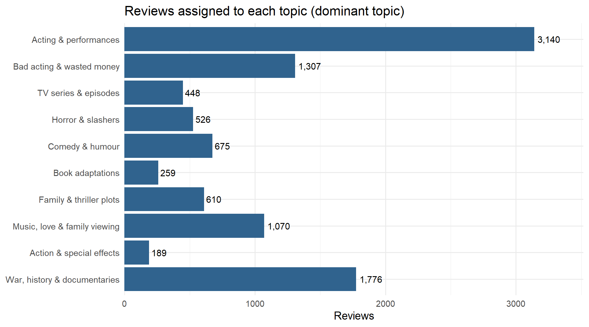{width=6.3in}

**What it shows.** How many of the 10,000 reviews have each topic as their strongest (dominant) topic.

**How to read it.** Acting & performances is by far the largest group at 3,140 reviews. War, history & documentaries (1,776), Bad acting & wasted money (1,307) and Music, love & family viewing (1,070) follow. Action & special effects is the smallest at 189.

**What it means.** Each review receives a score on all 10 topics and is assigned to the highest one. Acting is what reviewers write about most. Small topics are narrower themes, not unimportant ones.

**Say this to faculty.** "Assigning each review to its strongest topic shows acting is the dominant theme of IMDb reviews: almost a third of the sample."

# Stage 5: Sentiment analysis

Music and family content is praised (83% positive) while bad acting and wasted money drives complaints (6% positive), and all three dictionaries agree on that ranking. Each review was scored by adding up its words' values in three sentiment dictionaries (lexicons):

| Lexicon | How it scores a word | Size |
|---|---|---|
| AFINN (Nielsen, 2011) | An integer from −5 to +5 | about 2,500 words |
| Bing (Hu & Liu, 2004) | Positive or negative | about 6,800 words |
| NRC (Mohammad & Turney, 2013) | Positive/negative plus 8 emotions | about 6,500 words |

Average scores confirm the direction is right: positive reviews average AFINN +12.5 and Bing +4.1, negative reviews −1.4 and −3.1. NRC is positive even for negative reviews (+0.8), an early sign of its bias.

## Figure 9. Most common positive and negative words (Bing)

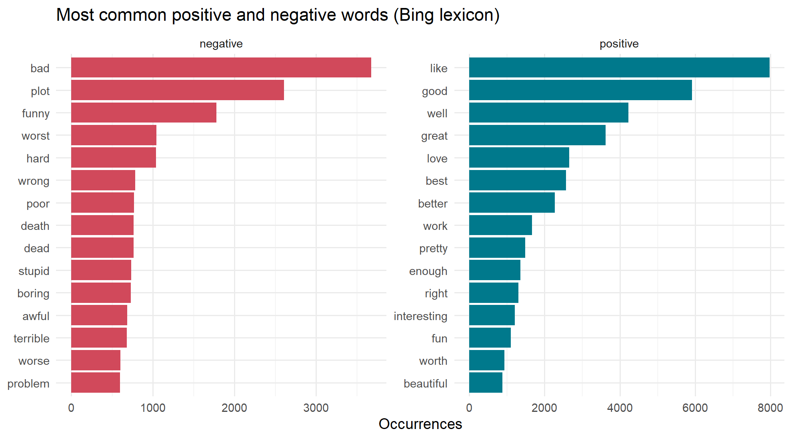{width=6.3in}

**What it shows.** The 15 most frequent words that the Bing dictionary labels negative (left, red) and positive (right, teal).

**How to read it.** Positive: *like* (about 8,000), *good*, *well*, *great*, *love*. Negative: *bad* (about 3,700), *plot*, *funny*, *worst*, *hard*.

**What it means.** It exposes a dictionary flaw. *Plot* and *funny* are labelled negative, but in movie reviews they are usually neutral ("the plot is about…") or positive ("very funny"). General-purpose lexicons misread domain words, which costs them accuracy.

**Say this to faculty.** "The dictionary counts *plot* and *funny* as negative words. In a movie review that is often wrong, which is one reason lexicons top out around 73% accuracy."

## Figure 10. Word cloud of the most frequent words

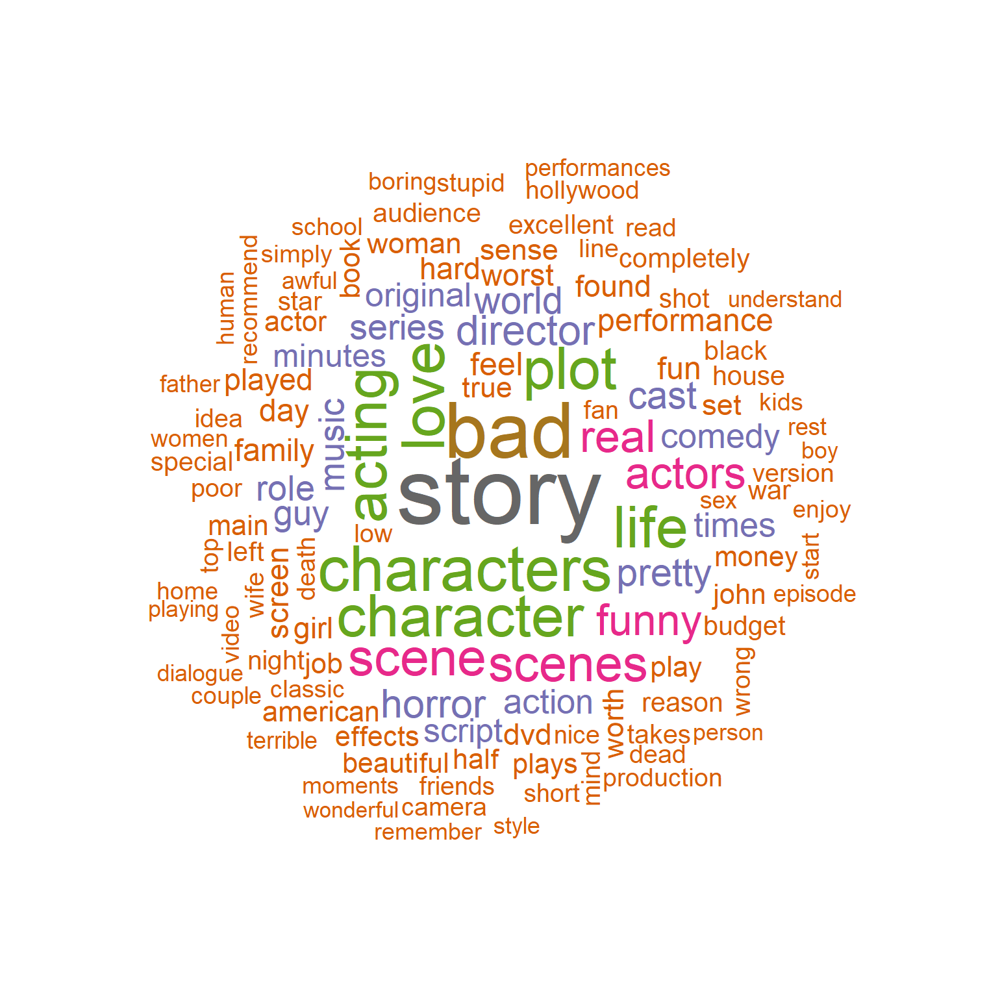{width=4.8in}

**What it shows.** The 120 most frequent words (stop words and generic movie words removed); larger means more frequent.

**How to read it.** *story*, *bad*, *characters*, *character*, *love*, *acting*, *plot* and *life* dominate, with *scenes*, *funny*, *horror* and *director* next.

**What it means.** A quick visual summary of what reviewers discuss: story, characters and acting come first. It previews the topics LSA later finds formally.

**Say this to faculty.** "At a glance, reviewers talk mostly about the story, characters and acting: the same themes LSA later separates into topics."

## Figure 11. Positive vs negative comparison cloud

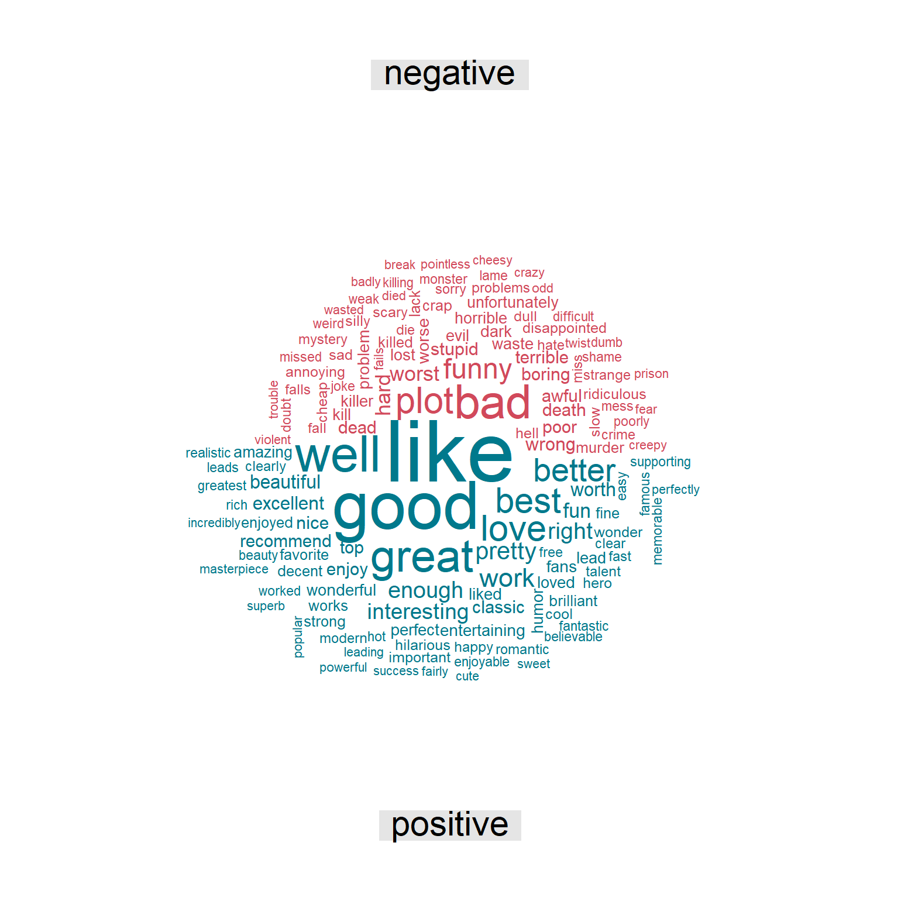{width=4.8in}

**What it shows.** Bing dictionary words split into negative (red, top) and positive (teal, bottom), sized by frequency.

**How to read it.** The largest positive words are *like*, *good*, *great*, *well* and *best*; the largest negative words are *bad*, *plot*, *funny* and *worst*.

**What it means.** The same information as Figure 9 in visual form. The positive half is visibly larger: reviews use far more positive vocabulary overall, even negative ones.

**Say this to faculty.** "Positive words outnumber negative ones across all reviews, which is why dictionaries tend to over-predict positive."

## Figure 12. NRC emotion profile of positive vs negative reviews

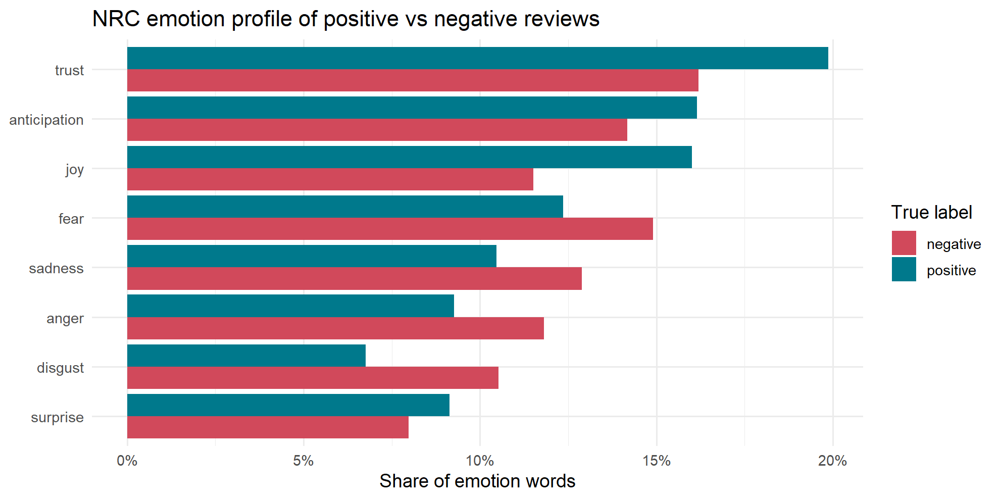{width=6.3in}

**What it shows.** Of all emotion words found, the share belonging to each of NRC's 8 emotions, for truly positive (teal) and truly negative (red) reviews.

**How to read it.** Positive reviews lead on **trust** (about 20% vs 16%), **joy** (16% vs 11.5%) and **anticipation**. Negative reviews lead on **fear** (15% vs 12%), **sadness**, **anger** and **disgust** (10.5% vs 7%).

**What it means.** Emotions line up with opinion exactly as expected, so the NRC lexicon captures real signal even though its overall accuracy is the lowest.

**Say this to faculty.** "Beyond positive and negative, NRC shows *how* people feel: positive reviews carry trust and joy, negative ones fear, anger and disgust."

## Figure 13. Topic versus sentiment

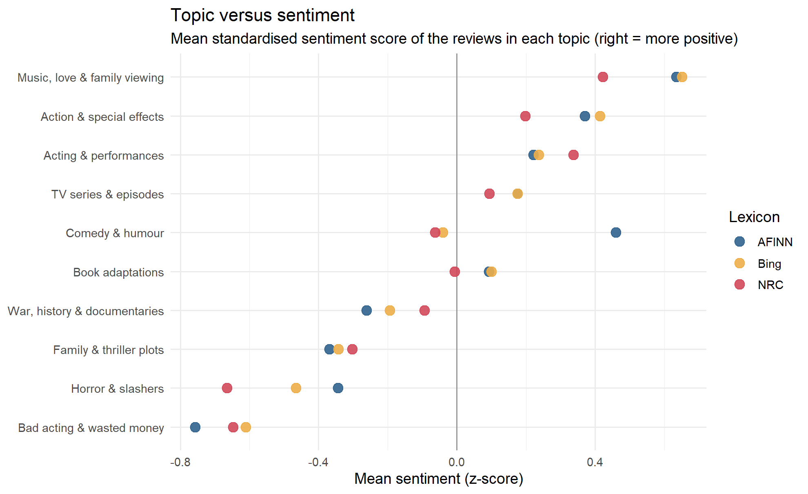{width=6.3in}

**What it shows.** Each topic's average sentiment score for each dictionary. Scores are standardised (z-scores) so the three dictionaries share one scale; right of zero = more positive than average.

**How to read it.** Music, love & family viewing sits furthest right; Bad acting & wasted money furthest left. Horror & slashers and Family & thriller plots lean negative. The three dots per topic mostly sit close together. The one exception is Comedy & humour: AFINN rates it positive, Bing and NRC slightly negative.

**What it means.** The topic ranking is robust because three independent dictionaries agree. The Comedy split shows lexicon choice can flip a conclusion: Bing counts *funny* as negative.

**Say this to faculty.** "Three different dictionaries rank the topics almost identically, so the result is not an artefact of one lexicon. Comedy is the exception, and we can explain exactly why."

## Figure 14. Which themes are praised and which are criticised?

{width=6.3in}

**What it shows.** The share of reviews in each topic that are truly positive, using the dataset's own labels rather than predictions. The dashed line is 50%.

**How to read it.** Music, love & family viewing is 83% positive, followed by TV series (64%), Action (62%) and Acting (60%). Horror (42%) leans negative. Bad acting & wasted money is only 6% positive.

**What it means.** This is the project's main business answer: it links **what** viewers discuss (topic) to **how** they feel (sentiment). A streaming team would invest in music and family content and treat poor acting as the biggest driver of complaints.

**Say this to faculty.** "This chart answers our research question: music and family themes are praised, while bad acting is almost always behind a negative review."

## Figure 15. NRC emotion mix within each topic

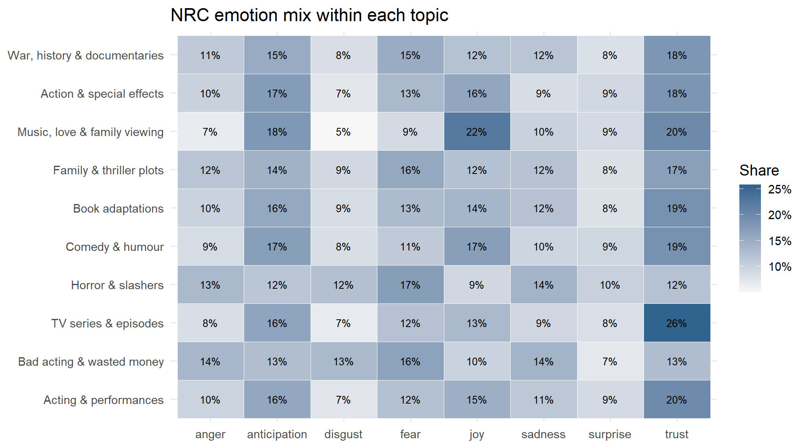{width=6.3in}

**What it shows.** A heatmap of topics (rows) by NRC emotions (columns); each cell is that emotion's share of the topic's emotion words, darker = larger.

**How to read it.** Music, love & family viewing has the most **joy (22%)**. TV series & episodes has the most **trust (26%)**. Horror & slashers has the most **fear (17%)** and the least joy (9%). Bad acting & wasted money is high on **anger (14%)** and **disgust (13%)**.

**What it means.** Each topic has its own emotional fingerprint, and the fingerprints make sense, which supports both the topics and the NRC lexicon.

**Say this to faculty.** "Horror reviews are full of fear words and music reviews full of joy: the emotions match the genres, which validates our topics."

# Stage 6: Validation

A trained logistic regression (84.8%) beats the best dictionary (Bing, 73.4%) by more than 11 percentage points. A review is predicted positive when its lexicon score is above 0; predictions are compared with the dataset's true labels. Guessing would score 50%, because the classes are balanced.

## Figure 16. Confusion matrices of the lexicon methods

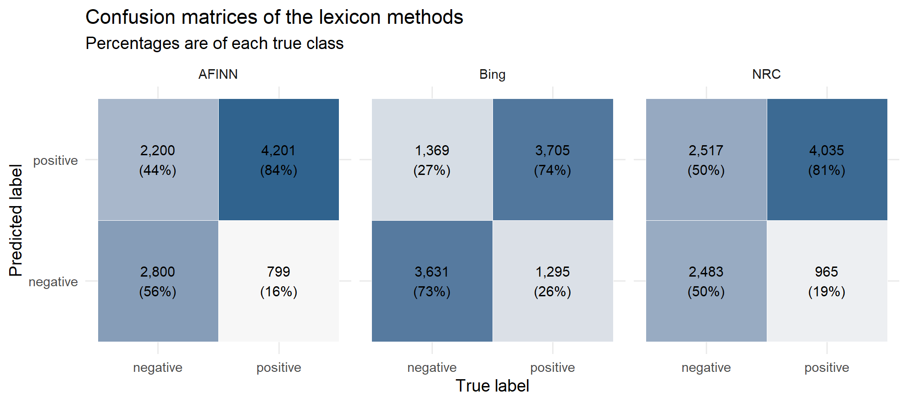{width=6.3in}

**What it shows.** For each dictionary, a 2 × 2 grid of predicted label (rows) against true label (columns), with counts and the percentage of each true class.

**How to read it.** Correct predictions sit top-right (predicted and truly positive) and bottom-left (predicted and truly negative). **AFINN** catches 84% of positive reviews but only 56% of negative ones. **Bing** is balanced at 74% and 73%. **NRC** catches 81% of positive reviews but just 50% of negative ones, a coin flip.

**What it means.** AFINN and NRC are biased towards "positive". Negative reviews still contain plenty of positive words ("great actors, *but* a terrible script"), so adding up words over-predicts praise. Sensitivity = recall on positive reviews; specificity = recall on negative reviews.

**Say this to faculty.** "Accuracy alone hides a bias: AFINN and NRC label most reviews positive and miss half the negative ones. Bing is the only balanced dictionary."

## Figure 17. Strongest words in the logistic regression

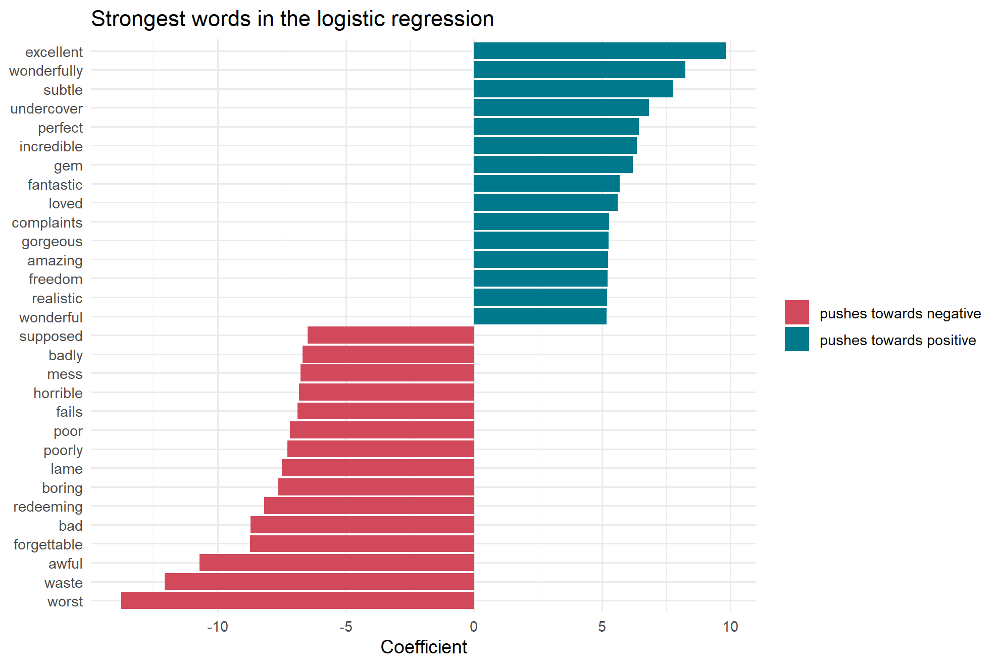{width=6.3in}

**What it shows.** The 15 words with the largest positive weights (teal) and the 15 with the largest negative weights (red) in the lasso logistic regression trained on tf-idf features.

**How to read it.** Positive: *excellent* (about +9.8), *wonderfully*, *subtle*, *perfect*, *incredible*, *gem*. Negative: *worst* (about −13.8), *waste*, *awful*, *forgettable*, *bad*, *redeeming*, *boring*, *lame*.

**What it means.** The model learned movie-specific signals that dictionaries do not have: *redeeming* (as in "no redeeming qualities"), *forgettable*, *supposed* ("supposed to be funny") and *gem*. The lasso kept only 1,012 of the 5,724 words, setting the rest to zero. That data-driven vocabulary is why it outperforms the lexicons.

**Say this to faculty.** "The model learns from labelled data which words matter in movie reviews. Words like *redeeming* and *forgettable* are strong negative signals that no general dictionary scores."

## Figure 18. Sentiment accuracy against the IMDb labels

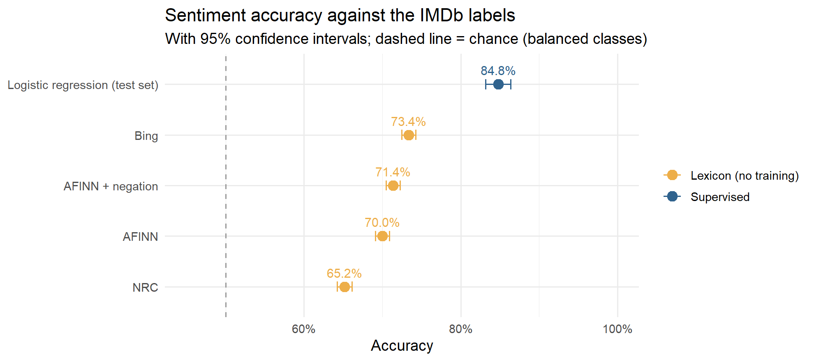{width=6.3in}

**What it shows.** Accuracy of each method against the true labels, with 95% confidence intervals (whiskers). The dashed line is chance (50%).

**How to read it.** NRC 65.2%, AFINN 70.0%, AFINN + negation 71.4%, Bing 73.4%, logistic regression **84.8%** (on 2,000 held-out reviews). The intervals do not overlap, so the gaps are statistically real.

**What it means.** Every method beats chance. Simple negation handling (flipping a word's score after *not*, *never*, *no*) adds 1.4 points to AFINN. A supervised model adds more than 11 points over the best dictionary. The dashboard model, trained on all 25,000 training reviews with two-word phrases, reaches **88.2%** on the 25,000 unseen test reviews.

**Say this to faculty.** "Dictionaries need no training and reach 65–73%. Learning from labelled reviews lifts accuracy to 84.8%, and to 88.2% with the full training set."

## Figure 19. LIME explanations of individual predictions

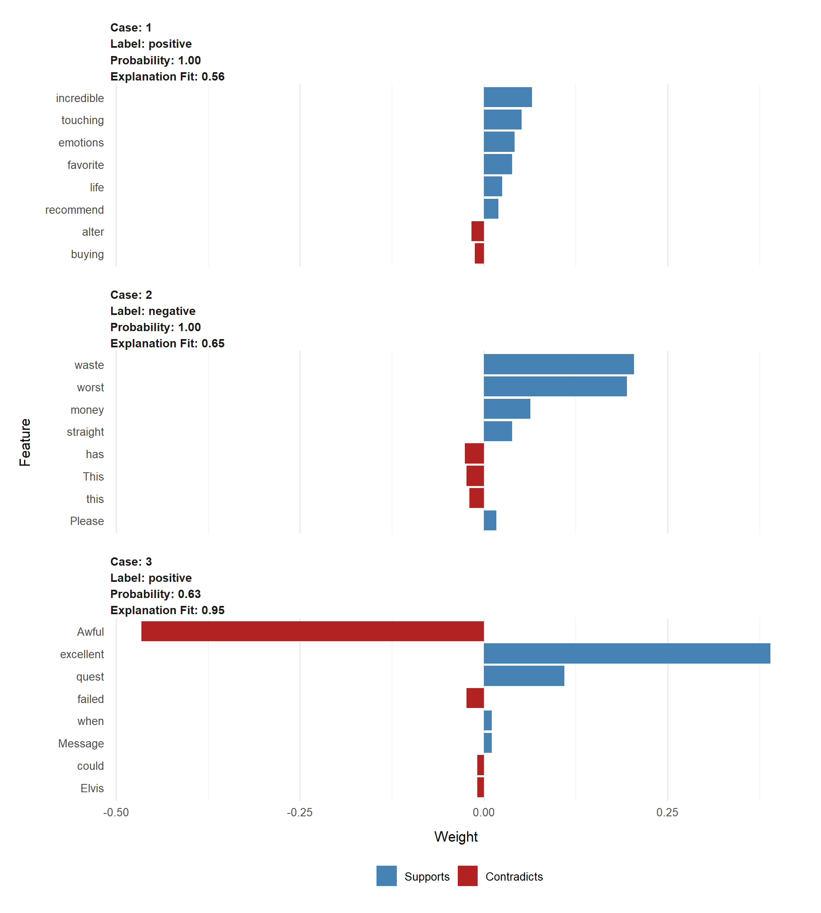{width=6.3in}

**What it shows.** For three test reviews, the words that most supported (blue) or contradicted (red) the model's prediction, as estimated by LIME. Each panel lists the predicted label, its probability and how well LIME's local explanation fits.

**How to read it.** Case 1 (positive, probability 1.00) rests on *incredible*, *touching*, *emotions*, *favorite* and *recommend*. Case 2 (negative, 1.00) rests on *waste*, *worst* and *money*. Case 3 was **misclassified** as positive (0.63): *excellent* pulled it up while *Awful* and *failed* pulled it down.

**What it means.** LIME removes words at random and watches the prediction change, to estimate each word's influence on one review. It shows the model is explainable, not a black box. Case 3 also reveals the weakness: mixed reviews with strong words on both sides can be misread.

**Say this to faculty.** "LIME lets us explain any single prediction. The misclassified case shows exactly why: one strong positive word outweighed the negative ones."

# Likely faculty questions

| Question | Short answer |
|---|---|
| Why 10 topics? | The scree plot (Figure 6) flattens after about 10 dimensions, and 10 topics are distinct and easy to name. |
| Why is variance explained so low (3.45% for 10 topics)? | Text matrices are spread over thousands of sparse words; low percentages are normal, so the elbow is used instead of a variance target. |
| Why a varimax rotation? | Raw LSA dimensions mix positive and negative loadings and the first one is generic vocabulary. Varimax spans the same space but concentrates each topic on fewer words, making it readable. |
| Why not LDA? | LSA was the method in our syllabus and is deterministic and fast. LDA usually gives cleaner topics and is listed as future work. |
| Why three lexicons? | To test whether conclusions depend on the dictionary chosen. They agree on the topic ranking (Figure 13), so the result is robust. |
| Why do lexicons lean positive? | Negative reviews still use many positive words ("good actors, but…"), and dictionaries ignore context and negation (Figure 16). |
| Why does logistic regression win? | It learns movie-specific word weights from labelled data, such as *redeeming* and *forgettable* (Figure 17). |
| Is 84.8% / 88.2% measured fairly? | Yes. 84.8% is on held-out reviews never used in training; 88.2% is on Stanford's separate 25,000-review test set, drawn from different movies. |
| Why sample 10,000 reviews? | It keeps the report fast (about 3 minutes) while staying balanced and large enough for stable results, as the proposal suggested. |
| What are the limitations? | Negation and sarcasm, domain words such as *plot* and *funny*, a judgement call on k, no neutral reviews, and the model needs reviews to predict a movie's reception. |

**One-line summary.** We used LSA to discover 10 hidden themes in IMDb reviews, measured sentiment with three dictionaries and a trained model (84.8% in the report, 88.2% on the full test set), and combined them to show which aspects of movies audiences praise and which they criticise.
